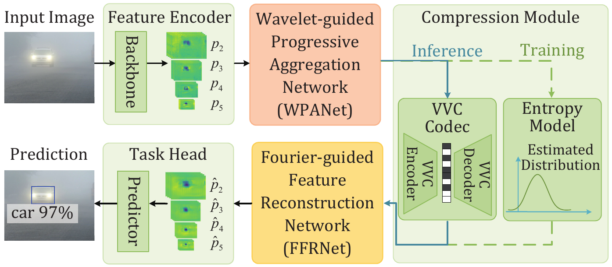

# Dual-Domain Frequency-Guided Multi-Scale Feature Compression for Vehicular Perception under Adverse Weather

**Authors:** Liqian Zhang, Zhaoqing Pan, Tiesong Zhao, Li Li, Fu Lee Wang, and Haoran Xie

## Abstract

Adverse weather conditions severely degrade visual observations in vehicular vision systems, while bandwidth constraints make it difficult to transmit multi-scale features with both low bitrate and high perception accuracy. Existing feature compression methods are mainly developed for clean images and generally overlook weather-induced degradation. Consequently, task-irrelevant degradation components may be encoded together with task-discriminative information, causing unnecessary bitrate consumption and degraded downstream perception performance. To address this issue, we propose a Dual-domain Frequency-guided Network (DFNet) for bandwidth-efficient and degradation-robust multi-scale feature compression in vehicular perception under adverse weather conditions. DFNet exploits complementary frequency cues from the wavelet and Fourier domains for task-irrelevant redundancy reduction and structure-preserving feature reconstruction. Specifically, a Wavelet-guided Progressive Aggregation Network (WPANet) is developed to generate compact degradation-aware representations through a purification-before-aggregation strategy. Within WPANet, a wavelet-decoupled semantic purification module purifies degradation-corrupted features by refining low-frequency semantics and compensating for informative high-frequency details, while a hierarchical semantic aggregation module aggregates purified features across adjacent scales into a compact representation. Furthermore, a Fourier-guided Feature Reconstruction Network (FFRNet) reconstructs discriminative multi-scale features by mitigating disturbances introduced by adverse-weather degradation and lossy compression. Its spectral-guided feature refinement module further recalibrates spatial features using Fourier-domain spectral cues. Extensive experiments on real-world and synthetic adverse-weather datasets demonstrate the effectiveness of DFNet in improving overall rate-accuracy performance compared with state-of-the-art multi-scale feature compression methods.

<p align="center">
  
</p>

## Requirements

| Name | Version | Name | Version | Name | Version |
| --- | --- | --- | --- | --- | --- |
| Python | 3.10.16 | PyTorch / torchvision | 2.5.1 / 0.20.1 | CUDA | 11.8 |
| FFmpeg | 4.2.2 | mamba-ssm | 2.2.3.post1 | causal-conv1d | 1.5.3.post1 |
| NumPy | 1.26.4 | OpenCV | 4.11.0.86 | pycocotools | 2.0.8 |

## Pretrained Model

Download the pretrained model from [Baidu Netdisk](https://pan.baidu.com/s/1NfclXcKiS-sKo5F72cadRg) (access code: `g4ot`). Set the downloaded checkpoint path as `pkl_path` in the corresponding test settings file.

## Usage

### 1. Dataset Preparation

**(1) Training set.** The training set comprises 85,900 images: 47,588 real-world BDD100K images and 38,312 PASCAL VOC images, including 9,578 clean training images and their corresponding foggy, rainy, and snowy versions.

**(2) Test sets.** The test sets comprise three real-world DAWN subsets—DAWN-Fog (300 images), DAWN-Rain (200), and DAWN-Snow (204)—and three synthetic PASCAL VOC subsets—VOC-Fog, VOC-Rain, and VOC-Snow—with 2,129 images per subset.

| Dataset | Purpose | Download |
| --- | --- | --- |
| DAWN | Real-world fog, rain, and snow test sets | [Mendeley Data](https://data.mendeley.com/datasets/766ygrbt8y/3) |
| PASCAL VOC | Clean source images for synthetic weather data | [Official PASCAL VOC website](https://www.robots.ox.ac.uk/~vgg/projects/pascal/VOC/) |
| BDD100K | Real-world images included in the training set | [Official BDD100K download documentation](https://github.com/bdd100k/bdd100k/blob/master/doc/source/download.rst) |
| RDMNet weather data | Synthetic VOC fog, rain, and snow subsets used for training and testing | [RDMNet dataset instructions](https://github.com/xfwang23/RDMNet) · [Dataset archive](https://drive.google.com/file/d/1q07ldCxjyKXasCfKP9p7pWbyRp93KqS9/view?usp=drive_link) |

### 2. Detector Checkpoint and Class Mapping

We adopt Faster R-CNN with a ResNeXt-101-FPN backbone, initialized from the COCO-pretrained checkpoint model_final_68b088.pkl from the official Detectron2 Model Zoo. The detector parameters remain frozen during training and evaluation, and the same detection model is used for all compared multi-scale feature compression methods. To ensure compatibility with the COCO-pretrained detector, the annotations of the DAWN and VOC datasets are converted into COCO format. During this conversion, category labels are mapped to the corresponding COCO category IDs using explicit class-name correspondences, including cases where category names differ between the original datasets and COCO. The same category-mapping and evaluation protocol is applied to all compared methods.

### 3. Training

Set the training parameters in [`faster_rcnn_X_101_32x8d_FPN_3x ours.yaml`](configs/COCO-Detection/faster_rcnn_X_101_32x8d_FPN_3x%20ours.yaml).

```bash
python tools/train_net.py \
  --config-file "configs/COCO-Detection/faster_rcnn_X_101_32x8d_FPN_3x ours.yaml" \
  --num-gpus 1 \
  OUTPUT_DIR output/dfnet_train
```

### 4. Testing

The testing procedure follows the coding protocol described below: 

**(1) Role of the Entropy Model and VVC Coding.** During training, a differentiable entropy model is employed to estimate the bitrate of the compact feature representations, enabling WPANet and FFRNet to be jointly optimized under the task and rate losses. Since VVC is non-differentiable, it is not involved in gradient-based optimization. During inference, the entropy-based rate estimation module is replaced by VVC for actual encoding and decoding of the learned compact representations. DFNet is trained only once with a fixed rate-accuracy trade-off parameter of λ = 0.15, while four operating points are obtained by adjusting the VVC QP during inference, without retraining the network.

**(2) Feature Quantization and Pseudo-Image Conversion.** During inference, WPANet generates a compact feature representation with dimensions H/64×W/64 × 192, where H and W denote the height and width of the preprocessed input image, respectively. The compact features are normalized to the range [0, 1023] using dataset-level minimum and maximum values and then quantized into 10-bit integer samples. The 192 feature channels are spatially arranged into a single-channel pseudo-image using a 12×16 grid in raster-scan order. Accordingly, the pseudo-image has a spatial resolution of 12H/64×16W/64, assuming that the feature dimensions require no additional padding. After VVC decoding, the decoded pseudo-image is rearranged into the original 192-channel layout and dequantized using the same normalization parameters. The reconstructed compact representation is subsequently fed into FFRNet for multi-scale feature reconstruction.  

**(3) VVC configuration and QP Settings.** The pseudo-images are encoded using VTM-12.0 under the All-Intra configuration, with a 10-bit input depth and a monochrome (4:0:0) chroma format. Rate-accuracy operating points are obtained for each test subset by adjusting the VVC QP without retraining the network. BD-rate is calculated relative to VVC-Intra based on the rate-accuracy curves, which enables bitrate comparisons at equivalent detection accuracy through interpolation over the overlapping accuracy range. To facilitate BD-rate comparison over a sufficiently overlapping mAP range, four operating points are selected for each method to approximate the mAP values of the corresponding VVC-Intra anchor points as closely as possible. The four QPs for each test subset are:

   <table border="1" style="border-collapse: collapse; width: 100%;">
     <thead>
       <tr><th>Test subset</th><th>QPs</th><th>Test subset</th><th>QPs</th></tr>
     </thead>
     <tbody>
       <tr><td>DAWN-Fog</td><td>22, 24, 28, 30</td><td>VOC-Fog</td><td>30, 32, 34, 36</td></tr>
       <tr><td>DAWN-Rain</td><td>22, 24, 25, 28</td><td>VOC-Rain</td><td>28, 30, 32, 34</td></tr>
       <tr><td>DAWN-Snow</td><td>19, 22, 26, 28</td><td>VOC-Snow</td><td>28, 30, 32, 34</td></tr>
     </tbody>
   </table>


For [`test_all_dataset_cocostyle_ours.py`](test_all_dataset_cocostyle_ours.py), set `DFNET_DATASET_ROOT` to your DAWN directory, choose the experiment IDs, datasets, and QPs in `id_dataset_qp_dict`, and provide a matching `settings/<experiment_id>_<dataset>_<qp>.json` file with the model config, checkpoint, and VTM settings. Run `uncompress` first, then run `evaluation` with the same settings.

```bash
python test_all_dataset_cocostyle_ours.py --mode uncompress
python test_all_dataset_cocostyle_ours.py --mode evaluation
```


## Supplementary Experimental Results


<details>
<summary><strong>1. FPN Feature Assumption Validation</strong> (click to expand)</summary>

To validate the key assumptions underlying the design of WPANet, we conducted two additional feature-level analyses focusing on the wavelet-domain frequency characteristics and inter-scale correlations of deep FPN features. Specifically, WPANet is motivated by the following two observations: (1) Wavelet-domain frequency characteristics: after Discrete Wavelet Transform (DWT), the low-frequency (LL) subband of deep FPN features contains the dominant task-relevant information, while the high-frequency (LH, HL, and HH) subbands provide complementary discriminative information. This motivates WSPM to refine low-frequency semantic components while selectively compensating for informative high-frequency components. (2) Inter-scale feature correlations: adjacent FPN levels exhibit stronger feature correlations than non-adjacent levels, motivating HSAM to progressively aggregate adjacent-scale features for inter-scale redundancy reduction. To quantitatively examine these two assumptions, we performed additional experiments for both object detection and instance segmentation using pretrained Faster R-CNN and Mask R-CNN, respectively. The experiments were conducted on the combined training and validation sets of the real-world Adverse Conditions Dataset with Correspondences (ACDC) [1.1], comprising 2,006 images, including 500 foggy, 500 rainy, 500 snowy, and 506 nighttime images. The feature extractors are kept fixed during these analyses, and no additional training or fine-tuning is performed.

#### (1) Validation of Wavelet-Domain Frequency Characteristics

To examine the relative contributions of different wavelet subbands to downstream perception, DWT is first applied to the original p2-p5 FPN features. The wavelet coefficients of selected subbands are retained, while those of the other subbands are set to zero before inverse DWT (IDWT). Specifically, three configurations are evaluated: Full DWT, which retains all four wavelet subbands; LF-only, which retains only the low-frequency LL subband; and HF-only, which retains only the three high-frequency LH, HL, and HH subbands. Since Full DWT retains all wavelet coefficients, IDWT reconstructs the original FPN features and therefore serves as the reference configuration.

**Table 1.1 Contributions of wavelet subbands to downstream perception performance under adverse weather conditions in terms of mAP@0.5 (%).**

<table border="1" cellspacing="0" cellpadding="5">
  <thead align="center">
    <tr><th rowspan="2" align="center">Subset</th><th colspan="3" align="center">Object Detection</th><th colspan="3" align="center">Instance Segmentation</th></tr>
    <tr><th align="center">Full DWT</th><th align="center">LF-only</th><th align="center">HF-only</th><th align="center">Full DWT</th><th align="center">LF-only</th><th align="center">HF-only</th></tr>
  </thead>
  <tbody>
    <tr><td align="center">Fog</td><td align="center">60.39</td><td align="center">59.73</td><td align="center">4.34</td><td align="center">57.90</td><td align="center">55.43</td><td align="center">4.58</td></tr>
    <tr><td align="center">Rain</td><td align="center">39.13</td><td align="center">37.63</td><td align="center">2.90</td><td align="center">42.03</td><td align="center">39.64</td><td align="center">2.39</td></tr>
    <tr><td align="center">Snow</td><td align="center">47.22</td><td align="center">46.22</td><td align="center">3.76</td><td align="center">49.05</td><td align="center">46.30</td><td align="center">4.25</td></tr>
    <tr><td align="center">Night</td><td align="center">28.48</td><td align="center">27.00</td><td align="center">2.37</td><td align="center">27.60</td><td align="center">25.83</td><td align="center">2.07</td></tr>
    <tr><td align="center">Average</td><td align="center">43.81</td><td align="center">42.65</td><td align="center">3.34</td><td align="center">44.15</td><td align="center">41.80</td><td align="center">3.32</td></tr>
  </tbody>
</table>

As shown in Table 1.1, for object detection, Full DWT achieves an average mAP@0.5 of 43.81%, while LF-only achieves 42.65%, corresponding to a decrease of only 1.16 percentage points. In contrast, HF-only achieves only 3.34%. A similar trend is observed for instance segmentation: Full DWT obtains 44.15%, LF-only achieves 41.80%, and HF-only achieves only 3.32%. These results show that the low-frequency LL subband preserves the majority of task-relevant information required for downstream perception. Meanwhile, Full DWT consistently outperforms LF-only by an average of 1.16 and 2.35 percentage points in object detection and instance segmentation, respectively. This indicates that the high-frequency subbands still contain complementary task-relevant information. These results provide direct quantitative support for the frequency-decoupled design of WSPM, in which low-frequency semantics are primarily refined while informative high-frequency components are selectively exploited for complementary enhancement. This observation is also consistent with WaveCNets [1.2], which highlights the dominant role of low-frequency information in deep feature representations while demonstrating the utility of high-frequency components for detail reconstruction in its segmentation extension.

#### (2) Validation of Inter-Scale Feature Correlations

To validate the assumption underlying the hierarchical adjacent-scale aggregation in HSAM, we analyze the correlations among different FPN levels. Specifically, the original p2-p5 features are spatially aligned to the resolution of p5 using adaptive average pooling. For each pair of FPN levels, the spatial feature map of each corresponding channel is flattened into a vector, and cosine similarity is computed between the two channel-wise vectors. The similarities are then averaged over all channels and images.

**Table 1.2 Inter-scale feature similarity analysis of FPN features under adverse weather conditions using cosine similarity.**

<table border="1" cellspacing="0" cellpadding="5">
  <thead align="center">
    <tr><th rowspan="2" align="center">Task</th><th rowspan="2" align="center">Subset</th><th colspan="3" align="center">Adjacent Scales</th><th colspan="3" align="center">Non-adjacent Scales</th></tr>
    <tr><th align="center">p2-p3</th><th align="center">p3-p4</th><th align="center">p4-p5</th><th align="center">p2-p4</th><th align="center">p3-p5</th><th align="center">p2-p5</th></tr>
  </thead>
  <tbody>
    <tr><td rowspan="5" align="center">Object Detection</td><td align="center">Fog</td><td align="center">0.655</td><td align="center">0.763</td><td align="center">0.633</td><td align="center">0.447</td><td align="center">0.409</td><td align="center">0.248</td></tr>
    <tr><td align="center">Rain</td><td align="center">0.663</td><td align="center">0.760</td><td align="center">0.634</td><td align="center">0.442</td><td align="center">0.401</td><td align="center">0.241</td></tr>
    <tr><td align="center">Snow</td><td align="center">0.655</td><td align="center">0.756</td><td align="center">0.629</td><td align="center">0.434</td><td align="center">0.395</td><td align="center">0.233</td></tr>
    <tr><td align="center">Night</td><td align="center">0.663</td><td align="center">0.758</td><td align="center">0.643</td><td align="center">0.442</td><td align="center">0.397</td><td align="center">0.241</td></tr>
    <tr><td align="center">Average</td><td colspan="3" align="center">0.684</td><td colspan="3" align="center">0.361</td></tr>
    <tr><td rowspan="5" align="center">Instance Segmentation</td><td align="center">Fog</td><td align="center">0.677</td><td align="center">0.782</td><td align="center">0.674</td><td align="center">0.461</td><td align="center">0.427</td><td align="center">0.275</td></tr>
    <tr><td align="center">Rain</td><td align="center">0.687</td><td align="center">0.778</td><td align="center">0.673</td><td align="center">0.457</td><td align="center">0.422</td><td align="center">0.271</td></tr>
    <tr><td align="center">Snow</td><td align="center">0.678</td><td align="center">0.771</td><td align="center">0.670</td><td align="center">0.445</td><td align="center">0.414</td><td align="center">0.262</td></tr>
    <tr><td align="center">Night</td><td align="center">0.685</td><td align="center">0.777</td><td align="center">0.673</td><td align="center">0.452</td><td align="center">0.420</td><td align="center">0.261</td></tr>
    <tr><td align="center">Average</td><td colspan="3" align="center">0.710</td><td colspan="3" align="center">0.381</td></tr>
  </tbody>
</table>

As shown in Table 1.2, for object detection, the average cosine similarity of adjacent FPN levels is 0.684, substantially higher than the 0.361 obtained for non-adjacent levels. For instance segmentation, the corresponding values are 0.710 and 0.381, respectively. This trend is consistently observed across all four adverse conditions. Moreover, the inter-scale feature similarity generally decreases as the separation between FPN levels increases. For example, under fog conditions in object detection, the cosine similarity of p3-p4 reaches 0.763, whereas those of p2-p4 and p2-p5 decrease to 0.447 and 0.248, respectively. These results provide direct quantitative evidence that adjacent FPN levels exhibit substantially stronger feature correlations than non-adjacent levels. These findings support the design of HSAM, which progressively aggregates adjacent-scale representations to exploit stronger inter-scale dependencies for reducing redundancy among multi-scale features. This observation is also consistent with SEPC [1.3], which reports stronger correlations between neighboring feature pyramid levels in object detection.

Overall, these two additional experiments provide quantitative evidence for the two key assumptions underlying WPANet, further justifying the frequency-decoupled design of WSPM and the hierarchical adjacent-scale aggregation strategy of HSAM, respectively.

**References**

- [1.1] C. Sakaridis, H. Wang, K. Li, R. Zurbrügg, A. Jadon, W. Abbeloos, D. Olmeda Reino, L. Van Gool, and D. Dai, “ACDC: The Adverse Conditions Dataset With Correspondences for Robust Semantic Driving Scene Perception,” *IEEE Transactions on Pattern Analysis and Machine Intelligence*, vol. 48, no. 3, pp. 2970–2988, 2026.
- [1.2] Q. Li, L. Shen, S. Guo and Z. Lai, “Wavelet Integrated CNNs for Noise-Robust Image Classification,” in *IEEE/CVF Conference on Computer Vision and Pattern Recognition (CVPR)*, 2020, pp. 7243–7252.
- [1.3] X. Wang, S. Zhang, Z. Yu, L. Feng and W. Zhang, “Scale-Equalizing Pyramid Convolution for Object Detection,” in *IEEE/CVF Conference on Computer Vision and Pattern Recognition (CVPR)*, 2020, pp. 13356–13365.

</details>

<details>
<summary><strong>2. BD-Rate Sensitivity Analysis</strong> (click to expand)</summary>

To evaluate the sensitivity of the reported BD-rate results to numerical calculation settings, we conducted additional analyses using different interpolation methods and numerical rounding precisions on the DAWN and VOC datasets.

#### (1) Sensitivity to Interpolation Methods
Following the interpolation methods discussed in [2.1], we compared three approaches: the original PCHIP-based interpolation, Cubic Spline Interpolation (CSI), and Akima interpolation. The same rate-accuracy operating points and corresponding mAP integration intervals are used, with only the interpolation method varied.

**Table 2.1 Sensitivity analysis of average BD-rate to different curve fitting methods on DAWN and VOC.** BD-rate is measured in %, and ΔBD represents the difference between each interpolation method and Original, measured in percentage points (pp).

<table border="1" cellspacing="0" cellpadding="5">
  <thead align="center">
    <tr><th rowspan="3" align="center">Methods</th><th colspan="5" align="center">DAWN</th><th colspan="5" align="center">VOC</th></tr>
    <tr><th align="center">Original</th><th colspan="2" align="center">CSI</th><th colspan="2" align="center">Akima</th><th align="center">Original</th><th colspan="2" align="center">CSI</th><th colspan="2" align="center">Akima</th></tr>
    <tr><th align="center">BD-rate</th><th align="center">BD-rate</th><th align="center">ΔBD</th><th align="center">BD-rate</th><th align="center">ΔBD</th><th align="center">BD-rate</th><th align="center">BD-rate</th><th align="center">ΔBD</th><th align="center">BD-rate</th><th align="center">ΔBD</th></tr>
  </thead>
  <tbody>
    <tr><td align="center">AFC</td><td align="center">-60.53</td><td align="center">-59.28</td><td align="center">1.25</td><td align="center">-60.61</td><td align="center">-0.08</td><td align="center">-86.11</td><td align="center">-86.05</td><td align="center">0.06</td><td align="center">-86.10</td><td align="center">0.01</td></tr>
    <tr><td align="center">HSIMO</td><td align="center">-72.83</td><td align="center">-71.84</td><td align="center">0.99</td><td align="center">-72.99</td><td align="center">-0.16</td><td align="center">-91.04</td><td align="center">-90.91</td><td align="center">0.13</td><td align="center">-91.02</td><td align="center">0.02</td></tr>
    <tr><td align="center">CSSB</td><td align="center">-66.64</td><td align="center">-68.59</td><td align="center">-1.95</td><td align="center">-67.34</td><td align="center">-0.70</td><td align="center">-87.29</td><td align="center">-87.27</td><td align="center">0.02</td><td align="center">-87.29</td><td align="center">0.00</td></tr>
    <tr><td align="center">HSSC</td><td align="center">-91.45</td><td align="center">-91.11</td><td align="center">0.34</td><td align="center">-91.46</td><td align="center">-0.01</td><td align="center">-95.71</td><td align="center">-95.71</td><td align="center">0.00</td><td align="center">-95.70</td><td align="center">0.01</td></tr>
    <tr><td align="center">LMSFC</td><td align="center">-90.11</td><td align="center">-89.10</td><td align="center">1.01</td><td align="center">-90.75</td><td align="center">-0.64</td><td align="center">-92.45</td><td align="center">-88.60</td><td align="center">3.85</td><td align="center">-92.05</td><td align="center">0.40</td></tr>
    <tr><td align="center">MCNN</td><td align="center">-94.70</td><td align="center">-94.77</td><td align="center">-0.07</td><td align="center">-94.62</td><td align="center">0.08</td><td align="center">-97.75</td><td align="center">-97.80</td><td align="center">-0.05</td><td align="center">-96.85</td><td align="center">0.90</td></tr>
    <tr><td align="center">Proposed</td><td align="center"><strong>-94.74</strong></td><td align="center"><strong>-94.83</strong></td><td align="center">-0.09</td><td align="center"><strong>-94.75</strong></td><td align="center">-0.01</td><td align="center"><strong>-98.46</strong></td><td align="center"><strong>-98.11</strong></td><td align="center">0.35</td><td align="center"><strong>-98.46</strong></td><td align="center">0.00</td></tr>
  </tbody>
</table>

As shown in Table 2.1, the maximum deviations in the average BD-rate of DFNet relative to the original PCHIP-based implementation are 0.09 and 0.35 percentage points on DAWN and VOC, respectively. Moreover, DFNet maintains the lowest average BD-rate among the compared methods under all three interpolation settings on both datasets. These results indicate that the average BD-rate of DFNet and its relative ranking remain stable across the tested interpolation methods, although some baseline methods exhibit larger numerical variations. Nevertheless, the average BD-rate improvement over MCNN on DAWN remains marginal.

#### (2) Sensitivity to Numerical Rounding

To investigate the influence of numerical precision, we compared the original rate-accuracy data with two rounding settings. In the original calculations, bpp and mAP are retained to six and four decimal places, respectively. In the Round-bpp setting, bpp values are rounded to four decimal places while the original mAP precision is preserved. In the Round-mAP setting, mAP values expressed in percentage points are rounded to two decimal places while the original bpp precision is retained. The PCHIP-based interpolation method is used consistently across all three settings.

**Table 2.2 Sensitivity analysis of average BD-rate to numerical rounding on DAWN and VOC.** BD-rate is measured in %, and ΔBD represents the difference between each rounding setting and Original, measured in percentage points (pp).

<table border="1" cellspacing="0" cellpadding="5">
  <thead align="center">
    <tr><th rowspan="3" align="center">Methods</th><th colspan="5" align="center">DAWN</th><th colspan="5" align="center">VOC</th></tr>
    <tr><th align="center">Original</th><th colspan="2" align="center">Round-bpp</th><th colspan="2" align="center">Round-mAP</th><th align="center">Original</th><th colspan="2" align="center">Round-bpp</th><th colspan="2" align="center">Round-mAP</th></tr>
    <tr><th align="center">BD-rate</th><th align="center">BD-rate</th><th align="center">ΔBD</th><th align="center">BD-rate</th><th align="center">ΔBD</th><th align="center">BD-rate</th><th align="center">BD-rate</th><th align="center">ΔBD</th><th align="center">BD-rate</th><th align="center">ΔBD</th></tr>
  </thead>
  <tbody>
    <tr><td align="center">AFC</td><td align="center">-60.53</td><td align="center">-60.52</td><td align="center">0.01</td><td align="center">-60.53</td><td align="center">0.00</td><td align="center">-86.11</td><td align="center">-86.12</td><td align="center">-0.01</td><td align="center">-86.12</td><td align="center">-0.01</td></tr>
    <tr><td align="center">HSIMO</td><td align="center">-72.83</td><td align="center">-72.85</td><td align="center">-0.02</td><td align="center">-72.83</td><td align="center">0.00</td><td align="center">-91.04</td><td align="center">-91.05</td><td align="center">-0.01</td><td align="center">-91.05</td><td align="center">-0.01</td></tr>
    <tr><td align="center">CSSB</td><td align="center">-66.64</td><td align="center">-66.62</td><td align="center">0.02</td><td align="center">-66.63</td><td align="center">0.01</td><td align="center">-87.29</td><td align="center">-87.30</td><td align="center">-0.01</td><td align="center">-87.29</td><td align="center">0.00</td></tr>
    <tr><td align="center">HSSC</td><td align="center">-91.45</td><td align="center">-91.44</td><td align="center">0.01</td><td align="center">-91.45</td><td align="center">0.00</td><td align="center">-95.71</td><td align="center">-95.71</td><td align="center">0.00</td><td align="center">-95.71</td><td align="center">0.00</td></tr>
    <tr><td align="center">LMSFC</td><td align="center">-90.11</td><td align="center">-90.11</td><td align="center">0.00</td><td align="center">-90.11</td><td align="center">0.00</td><td align="center">-92.45</td><td align="center">-92.45</td><td align="center">0.00</td><td align="center">-92.45</td><td align="center">0.00</td></tr>
    <tr><td align="center">MCNN</td><td align="center">-94.70</td><td align="center">-94.70</td><td align="center">0.00</td><td align="center">-94.70</td><td align="center">0.00</td><td align="center">-97.75</td><td align="center">-97.75</td><td align="center">0.00</td><td align="center">-97.75</td><td align="center">0.00</td></tr>
    <tr><td align="center">Proposed</td><td align="center"><strong>-94.74</strong></td><td align="center"><strong>-94.75</strong></td><td align="center">-0.01</td><td align="center"><strong>-94.74</strong></td><td align="center">0.00</td><td align="center"><strong>-98.46</strong></td><td align="center"><strong>-98.47</strong></td><td align="center">-0.01</td><td align="center"><strong>-98.46</strong></td><td align="center">0.00</td></tr>
  </tbody>
</table>

As shown in Table 2.2, the maximum deviation in the average BD-rate across the compared methods is 0.02 percentage points on both DAWN and VOC. For DFNet, the maximum deviation is only 0.01 percentage points. Furthermore, DFNet maintains the lowest average BD-rate under all three numerical precision settings on both datasets. These results indicate that numerical rounding has a limited influence on the reported average BD-rate values and relative rankings under the tested settings.

Overall, the sensitivity analyses demonstrate that the average BD-rate results are relatively stable under the evaluated interpolation and rounding settings. However, these analyses assess numerical robustness rather than statistical significance with respect to training randomness or test-data variability. Therefore, we do not interpret the small average BD-rate difference between DFNet and MCNN on DAWN as evidence of a statistically significant performance improvement.

**References**

- [2.1] C. Herglotz, H. Och, A. Meyer, G. Ramasubbu, L. Eichermüller, M. Kränzler, F. Brand, K. Fischer, D. T. Nguyen, A. Regensky, and A. Kaup, “The Bjøntegaard Bible: Why Your Way of Comparing Video Codecs May Be Wrong,” *IEEE Transactions on Image Processing*, vol. 33, pp. 987–1001, 2024.

</details>

<details>
<summary><strong>3. Comparison with Representative Frequency-Domain Designs</strong> (click to expand)</summary>

To further evaluate the proposed frequency-domain components, we conduct additional controlled comparisons with representative wavelet- and Fourier-domain designs. Since these methods were originally developed for different vision tasks rather than multi-scale feature compression, we adapt their core frequency-domain modules into our compression framework while keeping the remaining pipeline unchanged. Specifically, we replace WPANet with a progressive cross-scale fusion network built upon the Wavelet-Guided Fusion Module (WGFM) from SMWG-DETR [3.1], while retaining FFRNet. For the Fourier-domain comparison, we replace the SFRMs in FFRNet with the Fourier-domain branch from [3.2], while keeping WPANet unchanged. These two variants are denoted as “w/ WGFM” and “w/ Fourier Branch”, respectively.

**Table 3.1 Comparison with existing frequency-domain methods, and BD-rate is calculated using VVC-Intra as the anchor (Unit: %).**

<table border="1" cellspacing="0" cellpadding="5">
  <thead align="center">
    <tr><th align="center">Method</th><th align="center">DAWN-Fog</th><th align="center">DAWN-Rain</th><th align="center">DAWN-Snow</th><th align="center">Average</th></tr>
  </thead>
  <tbody>
    <tr><td align="center">w/ WGFM</td><td align="center">-85.66</td><td align="center">-96.13</td><td align="center">-92.04</td><td align="center">-91.28</td></tr>
    <tr><td align="center">w/ Fourier Branch</td><td align="center">-89.47</td><td align="center">-95.67</td><td align="center">-90.64</td><td align="center">-91.93</td></tr>
    <tr><td align="center">Proposed</td><td align="center"><strong>-92.12</strong></td><td align="center"><strong>-97.83</strong></td><td align="center"><strong>-94.27</strong></td><td align="center"><strong>-94.74</strong></td></tr>
  </tbody>
</table>

As shown in Table 3.1, the “w/ WGFM” and “w/ Fourier Branch” variants achieve average BD-rates of -91.28% and -91.93%, respectively, whereas the proposed DFNet achieves -94.74%, corresponding to improvements of 3.46 and 2.81 percentage points. DFNet also achieves the best BD-rate under all three adverse-weather conditions. These results further demonstrate that the proposed wavelet- and Fourier-domain designs provide more effective rate-accuracy optimization than the adapted representative frequency-domain alternatives.

**References**

- [3.1] M. Chen, W. Zhao, N. Li, D. Li, R. Zhang, and J. Xu, “SMWG-DETR: DETR Enhanced by Fourier Spectral Modulation and Wavelet-Guided Fusion for Tiny Object Detection,” *IEEE Transactions on Geoscience and Remote Sensing*, vol. 64, pp. 1–17, 2026.
- [3.2] X. Jiang, N. Gao, X. Zhang, H. Dou, S. Fu, X. Zhong, H. Li, and Y. Deng, “Image Restoration via Multi-Domain Learning,” *IEEE Transactions on Pattern Analysis and Machine Intelligence*, vol. 48, no. 10, pp. 13685–13702, 2026.

</details>


